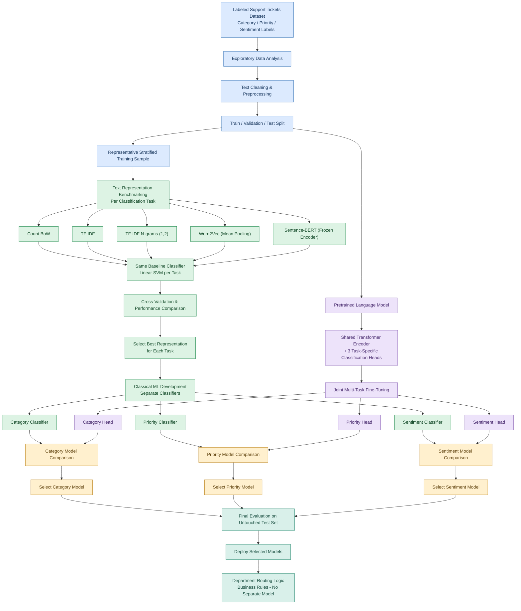

## Model Development & Evaluation Workflow

The following workflow illustrates the end-to-end process of developing and evaluating machine learning models for support ticket classification, including dataset preparation, text representation benchmarking, classical machine learning, multi-task transformer fine-tuning, model comparison, and final model selection for deployment.

