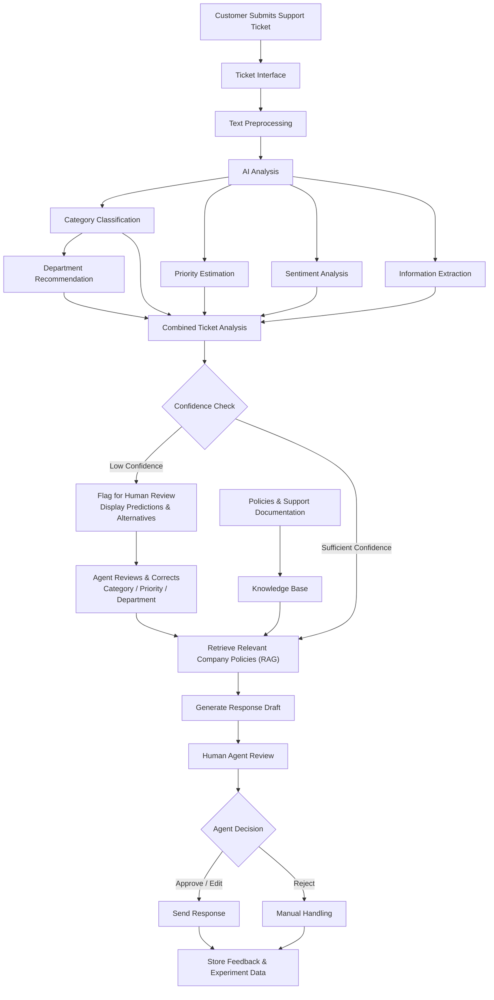

## End-to-End Support Ticket Processing Workflow

The following workflow illustrates how incoming support tickets are processed, analyzed, prioritized, and routed, followed by policy retrieval, response generation, and human review.

